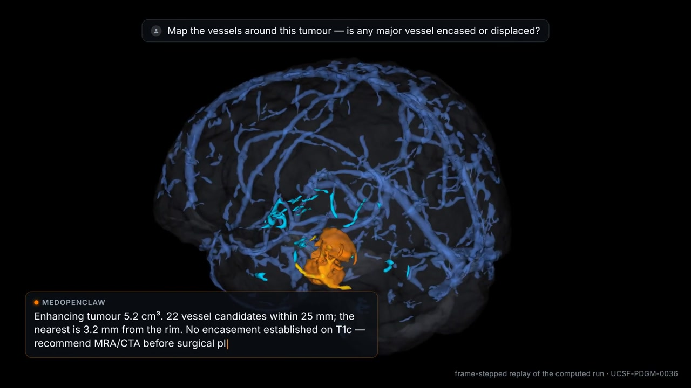

# MedOpenClaw

Medical imaging agents that operate viewers over complete radiology studies and whole-slide pathology images.

[**Watch the project video (1:36)**](https://jakobshen.github.io/MedOpenClaw/#project-film) · [Project homepage](https://jakobshen.github.io/MedOpenClaw/) · [Paper](https://arxiv.org/abs/2603.24649)
